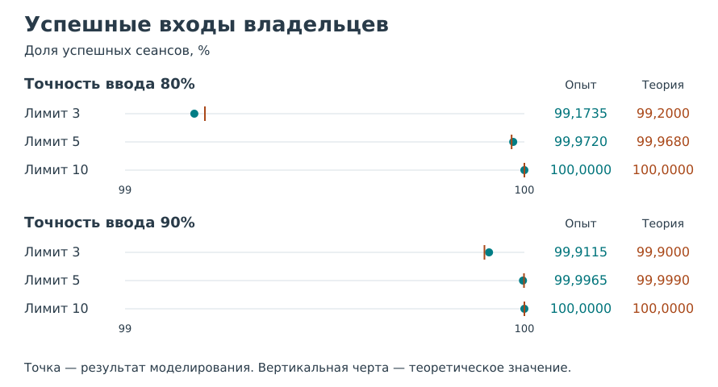
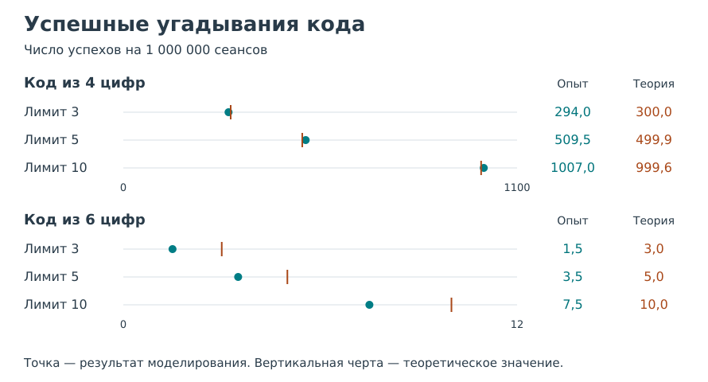

# Исследование влияния ограничения попыток на безопасность входа в систему

Курсовая работа, вариант № 1. Программа моделирует сеансы входа владельца и случайного угадывания кода. Правильный ввод завершает сеанс сразу, в том числе на последней разрешённой попытке. Если все разрешённые попытки израсходованы, сеанс завершается блокировкой.

## Сборка и запуск

Из корня проекта в Linux с компилятором g++:

```sh
g++ -O2 -std=c++17 -Wall -Wextra -pedantic main.cpp -o course-work
./course-work
```

## Проверка счётчика

Программа читает заранее заданные последовательности. Знак `+` означает правильный ввод, знак `-` — ошибку. Например, при лимите 5 последовательность `-----+` заканчивается блокировкой на пятой ошибке. Шестой символ остаётся непрочитанным.

Для каждого примера программа сверяет исход, значение счётчика и количество прочитанных символов с ожидаемым результатом. Если все проверки прошли, код завершения равен 0.

## Эксперимент

Для каждого из 12 сочетаний программа моделирует 100 000 сеансов владельца и 1 000 000 сеансов подбора. Каждый сеанс начинается с новым счётчиком. Попытки независимы. Вероятность успеха владельца при одной попытке равна 80% или 90%, а вероятность угадывания равна 1/10 000 для четырёх цифр и 1/1 000 000 для шести. Лимит составляет 3, 5 или 10 ошибок.

В [таблице результатов](results.tsv) доли успешных сеансов указаны в процентах. Среднее число попыток для каждой группы учитывает все её сеансы, включая завершившиеся блокировкой. Генератор инициализируется числом 42, поэтому запуски одной сборки воспроизводимы.

Чтобы обновить таблицу, выполните `./course-work > results.tsv`. Столбцы разделены табуляцией. Сообщения о проверке счётчика выводятся в терминал отдельно.

## Сопоставление с теорией

Пусть вероятность правильного ввода за одну попытку равна _p_, а лимит равен _N_. Блокировка требует _N_ ошибок подряд, поэтому её вероятность равна (1 − _p_)ᴺ. Вероятность успеха за сеанс равна 1 − (1 − _p_)ᴺ. До каждой следующей попытки доходят только после всех предыдущих ошибок. Суммируя вероятности дойти до попыток с первой по последнюю, получаем среднее число попыток [1 − (1 − _p_)ᴺ] / _p_.



По условию точность владельца одинакова для обеих длин кода. Поэтому каждая точка на первой диаграмме объединяет две строки таблицы, всего 200 000 сеансов. При точности 80% и лимите 5 успешны 99,972% сеансов при расчётных 99,968%. Для шестизначного кода среднее число попыток владельца составило 1,2524 при расчётном 1,2496.



Для второй диаграммы объединены два прогона с одинаковыми длиной кода и лимитом. Число угадываний разделено на два, чтобы показать частоту на миллион сеансов. У каждой длины кода своя шкала. При лимите 5 для четырёх цифр получено 509,5 угадывания на миллион, для шести — 3,5. Расчёт даёт приблизительно 500 и 5 соответственно. При редком событии даже несколько дополнительных успехов заметно меняют наблюдаемую частоту.

## Выбор настроек

Для условий задачи выбран **шестизначный код с лимитом 5 попыток**. При одинаковом лимите две дополнительные цифры снижают расчётную вероятность угадывания примерно в 100 раз. Вероятность ошибки владельца задана отдельно от длины кода.

При точности владельца 80% лимит 3 даёт в среднем 800 блокировок на 100 000 сеансов. Лимит 5 снижает это число до 32, при этом ожидаемое число угадываний шестизначного кода возрастает с 3 до 5 на миллион. При точности 90% и пяти попытках ожидается всего одна блокировка на 100 000 сеансов.

Переход с 5 до 10 попыток при точности 80% предотвращает ещё около 32 блокировок на 100 000 сеансов, а ожидаемое число угадываний вновь возрастает, с 5 до 10 на миллион. Большая часть выигрыша для владельца достигается уже при пяти попытках. Этот выбор отражает компромисс между двумя показателями при заданных в модели вероятностях.
